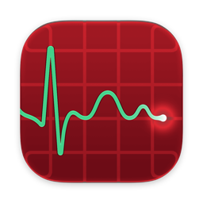
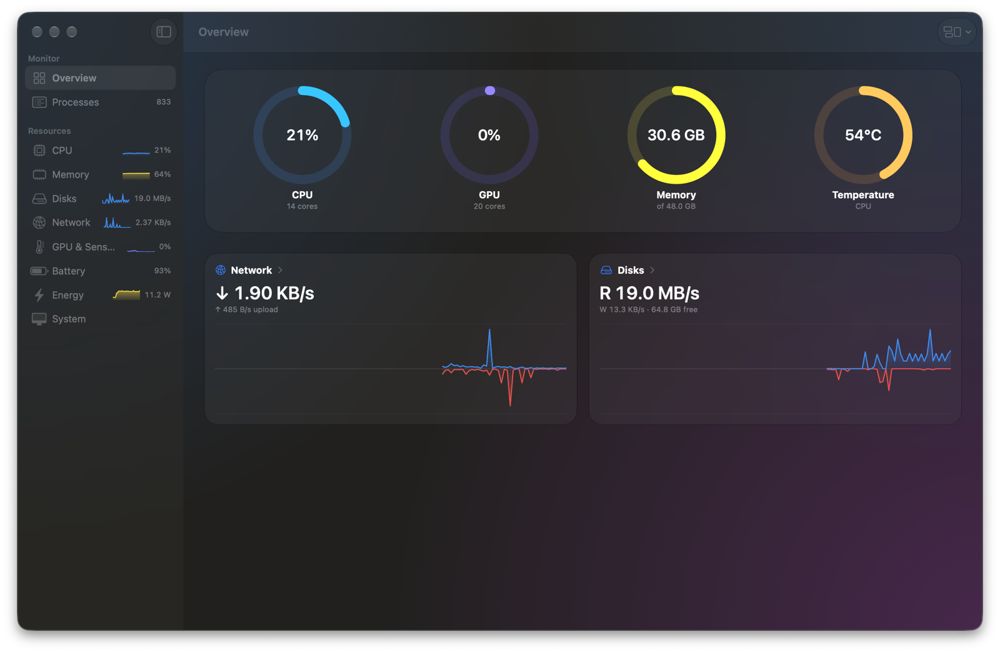
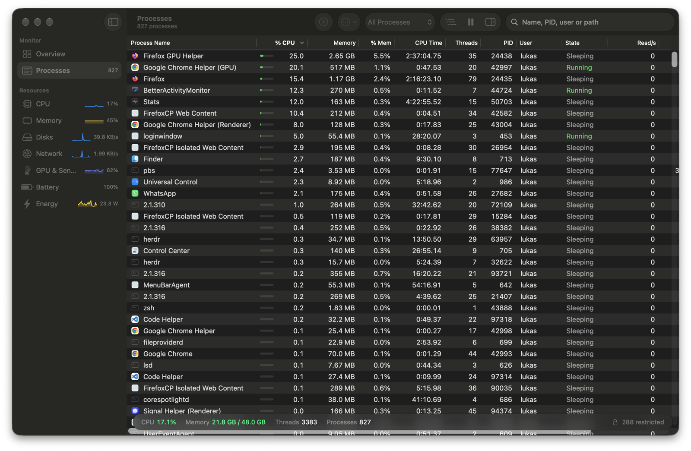
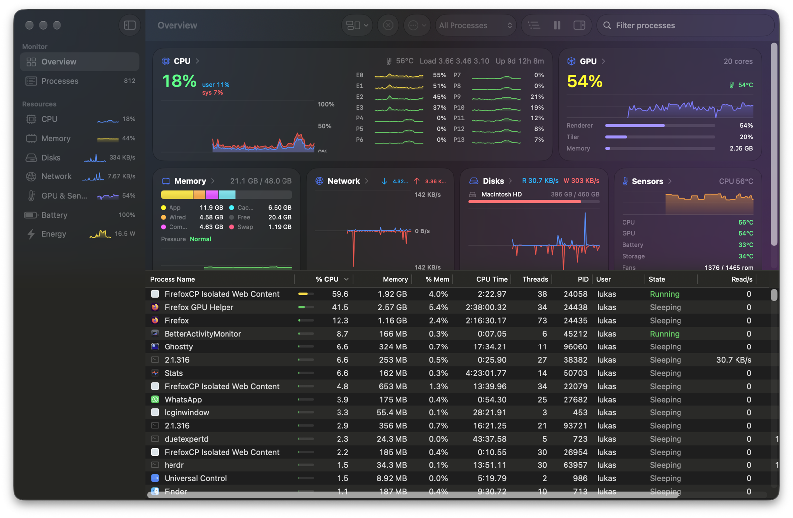
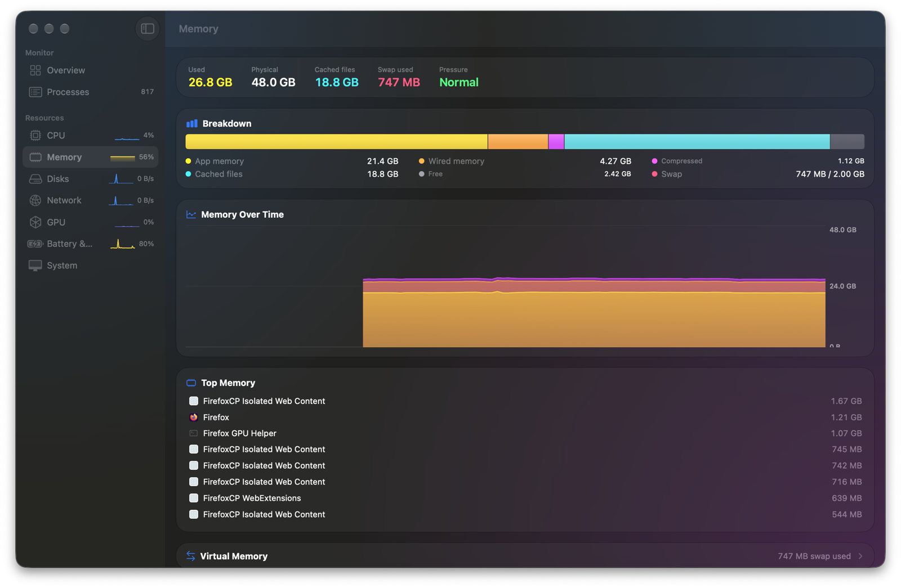
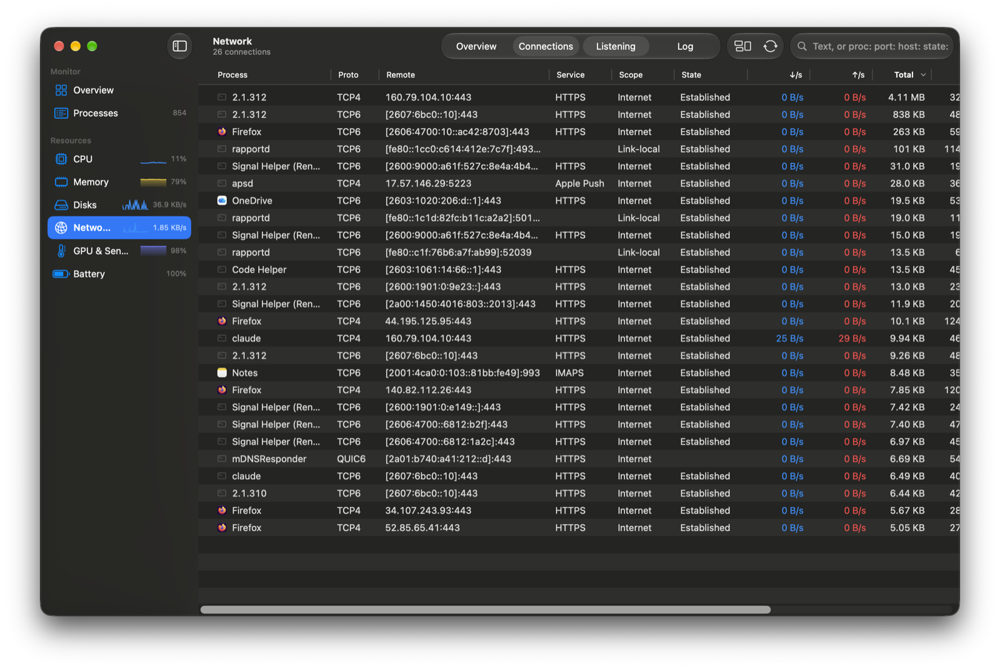

<div align="center">



# BetterActivityMonitor

**A native macOS system monitor with btop's depth and Activity Monitor's polish.**

See what your Mac is doing at a glance: CPU, GPU, memory, network, disks, temperatures, fans and battery,
plus a fast process list that lets you find, inspect and stop any app.

[](https://github.com/lukasketzer/BetterActivityMonitor/actions/workflows/ci.yml)
[](https://github.com/lukasketzer/BetterActivityMonitor/releases/latest)


[](LICENSE)

[**Download**](https://github.com/lukasketzer/BetterActivityMonitor/releases/latest) ·
[Features](#features) ·
[Build from source](#build-from-source) ·
[Permissions](#permissions) ·
[Contributing](docs/CONTRIBUTING.md)

<br>



</div>

## Screenshots

| | |
|:---:|:---:|
| <br>**Processes** | <br>**CPU** |
| <br>**Memory** | <br>**Network: listening apps** |

## Features

- **See how your Mac is doing at a glance**: the Overview shows CPU, GPU, memory and temperature as
  rings and graphs network and disk activity. Pick what it shows.
- **Find and control any process**: sort by what's using the most, search as you type, or show just your apps.
  See which process started which in a tree view. Quit, force quit or pause a process, change its priority,
  or open it for a closer look.
- **CPU in detail**: overall load, a graph for every core, and the CPU temperature, so you see what's slowing
  your Mac down.
- **Memory at a glance**: how much is in use, by what, and whether your Mac is running out.
- **See who's online**: live download and upload speeds, which apps are connected to where, which apps are
  waiting for connections, and a log of connections as they come and go.
- **Disks**: free space on each drive, and how fast data is being read and written.
- **Temperatures and fans**: CPU, GPU, battery and SSD temperatures, plus fan speeds.
- **Battery**: charge, health, charge cycles, power use and time remaining.
- **Desktop widgets**: put live CPU, GPU, memory, disk, battery and uptime widgets on your desktop or in
  Notification Center: rings, bars, or graphs of the last day. Edit a widget to choose its metrics; click it to
  jump to that screen.
- **Menu bar**: a compact menu bar item that looks like the system's own. Show the metrics you pick as rings,
  percentages or absolute values (like memory in use or battery time left), in the order you like.
- **Make it yours**: the glassy macOS 26 look, color themes (including btop, Nord and Dracula), several graph
  styles, and °C or °F.
- **Light on your Mac**: built to stay cheap to leave open all day.

## Install

1. Download `BetterActivityMonitor-<version>.dmg` from the
   [latest release](https://github.com/lukasketzer/BetterActivityMonitor/releases/latest).
2. Open it and drag **BetterActivityMonitor** to **Applications**.
3. **First launch:** releases without notarization are ad-hoc signed, so Gatekeeper blocks a plain double-click.
   Right-click the app → **Open** (on macOS 15+: *System Settings → Privacy & Security → Open Anyway*), or run:

   ```sh
   xattr -dr com.apple.quarantine /Applications/BetterActivityMonitor.app
   ```

Requires macOS 14 Sonoma or later on Apple Silicon. Liquid Glass needs macOS 26; older systems get standard
materials. Each release lists its `SHA256SUMS`.

### Nightly builds

`main` is built every night it has new changes and published as the
[nightly release](https://github.com/lukasketzer/BetterActivityMonitor/releases/tag/nightly), versioned like
`0.2.0-nightly.20261031`. Nightlies have the newest features before they are released, and may be rough. What's new
since the last release is in the [changelog](docs/CHANGELOG.md) under *Unreleased*.

## Build from source

You need Xcode 26 or later (for the macOS 26 SDK).

```sh
git clone https://github.com/lukasketzer/BetterActivityMonitor.git
cd BetterActivityMonitor
scripts/build-app.sh                  # release build with widgets → build/xcode/Release/BetterActivityMonitor.app
open build/xcode/Release/BetterActivityMonitor.app
```

You can also open `BetterActivityMonitor.xcodeproj` in Xcode. `scripts/bundle.sh` makes a quicker SwiftPM build
without the widgets.

More on the build, tests and tooling in [CONTRIBUTING.md](docs/CONTRIBUTING.md).

## Permissions

BetterActivityMonitor asks for nothing at launch. It doesn't need Accessibility, Screen Recording or Full Disk
Access, and it has no account, analytics or update check. This is everything it can ask macOS for, and when:

| What | When you see it | Why |
|---|---|---|
| Administrator password | Only when you quit, pause or renice another user's (or a system) process | The kernel only lets you signal or reprioritize your own processes. For anyone else's, the app shows the standard macOS password prompt and runs that one `kill` or `renice` as administrator. The password goes to macOS, not to the app. |
| Apple events | Once, before the first password prompt | The password prompt is shown through AppleScript (`do shell script … with administrator privileges`), so macOS may ask whether the app may send Apple events. It's the app's only privacy permission (`NSAppleEventsUsageDescription`). Change it in *System Settings → Privacy & Security → Automation*. |

These need no permission at all:

- **Other users' processes.** Without root, the kernel refuses per-process CPU and memory figures for processes
  that aren't yours. These show "—". The app doesn't ask to run as root to fill them in.
- **Temperatures and fans** are read from the SMC (`AppleSMC`), read-only. The keys vary by Mac model, so some
  sensors may be missing on yours. Please [report it](https://github.com/lukasketzer/BetterActivityMonitor/issues/new).
- **Network connections** come from the system's `nettop` tool, which works without root. It runs only while a
  Network page or network column that needs it is open.
- **Desktop widgets** run sandboxed. They share one day of history with the app through an App Group container on
  your Mac, so their graphs keep going after you quit the app.

## Roadmap

- [x] Network connections, listening sockets and connection log
- [x] Desktop and Notification Center widgets
- [x] Customizable menu bar item
- [ ] More settings
- [ ] Notarized builds

Ideas and requests: [open an issue](https://github.com/lukasketzer/BetterActivityMonitor/issues/new).

## Contributing

Bug reports, ideas and pull requests are welcome. [CONTRIBUTING.md](docs/CONTRIBUTING.md) covers the project layout,
the tests and benchmarks to run before a pull request, the developer tooling and how releases are cut.

## License

[MIT](LICENSE) © Lukas Ketzer. BetterActivityMonitor isn't affiliated with Apple. Activity Monitor is a
trademark of Apple Inc.
